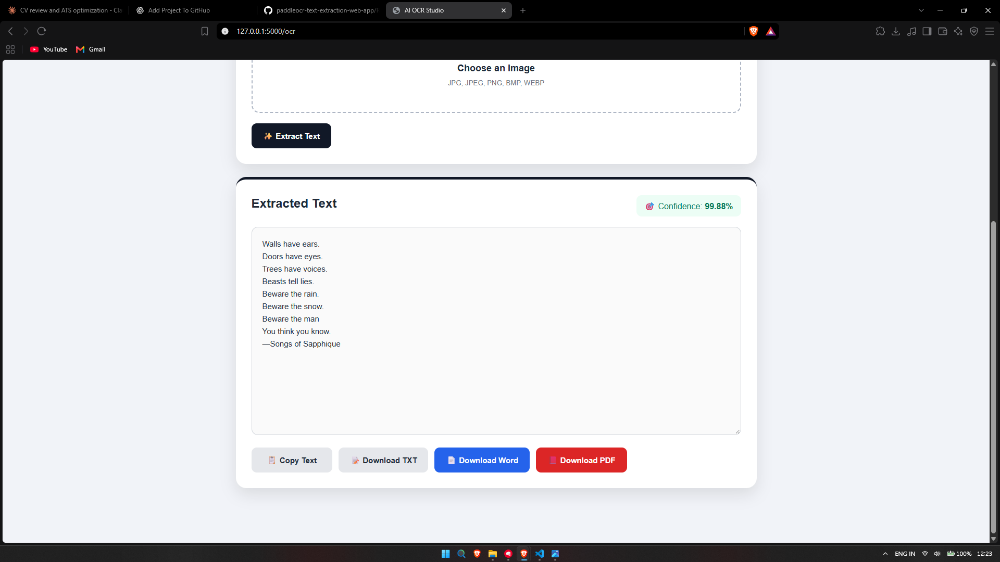

# PaddleOCR Text Extraction Web App

A web-based Optical Character Recognition (OCR) application built using **Python, Flask, and PaddleOCR** to extract text from images through a simple and user-friendly interface.

## Overview

This project demonstrates the integration of OCR technology with a Flask web application. Users can upload an image, extract its text using PaddleOCR, view the recognized content, and download the extracted text in supported formats.

## Features

- Image upload through a web interface
- Text recognition using PaddleOCR
- Display extracted text in an editable text area
- Confidence score display for OCR results
- Copy extracted text to the clipboard
- Download extracted text as a TXT file
- Export extracted text to Word and PDF formats
- Simple interface built with HTML, CSS, and JavaScript

*Note: Features listed above should be retained only if they are implemented and working in your current version.*

## Demo

### Input Image

The application accepts an image containing printed or scanned text.


### OCR Output

The application displays the recognized text and the confidence score returned by the OCR pipeline.



## Technologies Used

- **Programming Language:** Python
- **OCR Engine:** PaddleOCR
- **Backend Framework:** Flask
- **Frontend:** HTML, CSS, JavaScript
- **Development Tools:** Visual Studio Code, GitHub

## Project Structure

```text
paddleocr-text-extraction-web-app/
├── app.py
├── requirements.txt
├── test_ocr.py
├── README.md
├── templates/
│   └── index.html
├── static/
│   ├── style.css
│   └── script.js
└── screenshots/
    ├── ocr-input.jpg
    └── ocr-output.png
```

## Installation and Setup

### Prerequisites

- Python installed on your computer
- pip package manager
- Internet connection for installing dependencies and downloading OCR models when required

### 1. Clone the repository

```bash
git clone https://github.com/sreejeevr/paddleocr-text-extraction-web-app.git
cd paddleocr-text-extraction-web-app
```

### 2. Create a virtual environment

```bash
python -m venv venv
```

Activate the environment on Windows:

```powershell
venv\Scripts\activate
```

### 3. Install dependencies

```bash
pip install -r requirements.txt
```

### 4. Run the application

```bash
python app.py
```

Open the local URL shown in the terminal in your web browser.

## Testing

The repository includes `test_ocr.py` for testing OCR functionality.

Run the test script using:

```bash
python test_ocr.py
```

Ensure any required sample images and dependencies are available before running the test.

## Applications

- Extracting text from printed documents
- Digitizing scanned pages
- Converting image-based text into editable content
- Supporting document processing workflows

## Future Improvements

- Add broader PDF processing support
- Improve OCR results through image preprocessing
- Support additional languages
- Add batch image processing
- Deploy the application online

## Author

**Sreejeev R Chandran**

GitHub: [@sreejeevr](https://github.com/sreejeevr)

Project Repository: [PaddleOCR Text Extraction Web App](https://github.com/sreejeevr/paddleocr-text-extraction-web-app)

---

Developed as a Python and AI/ML project focused on optical character recognition and document text extraction.
